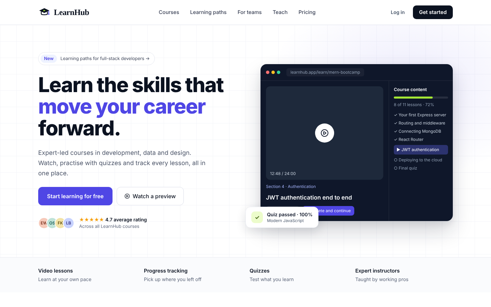
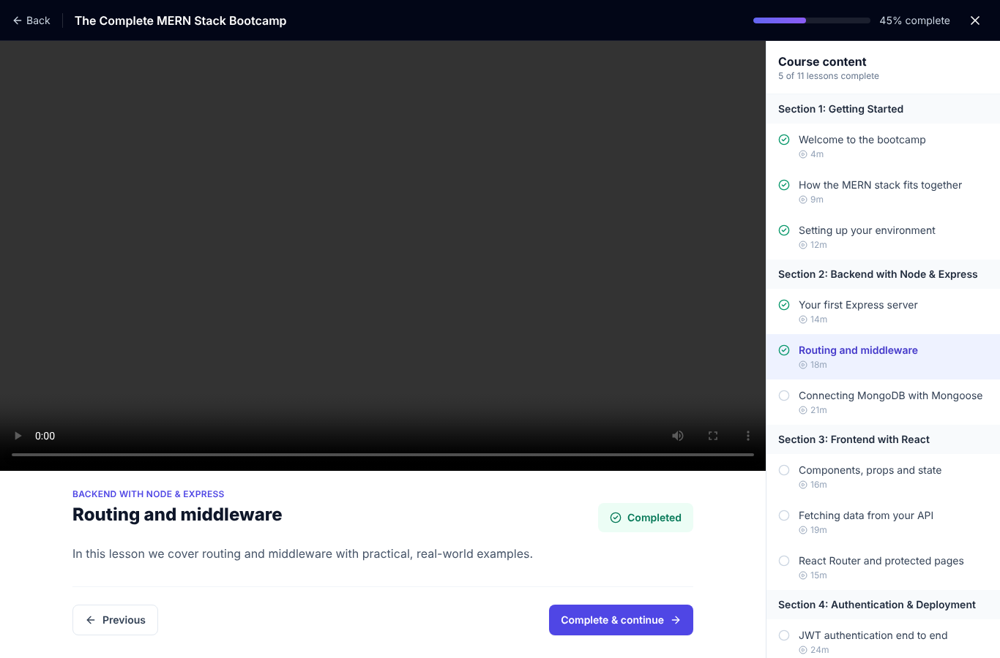
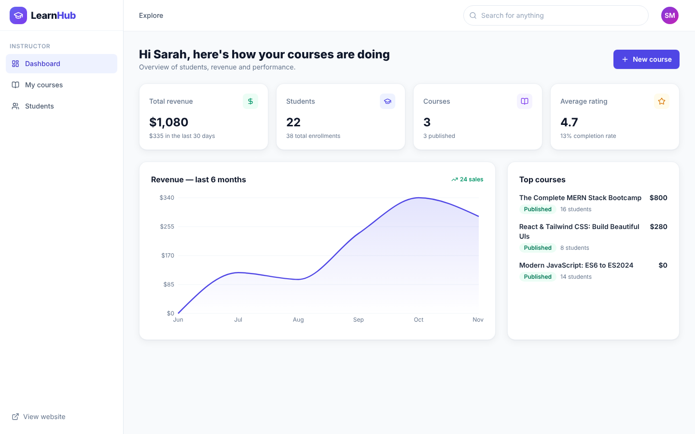
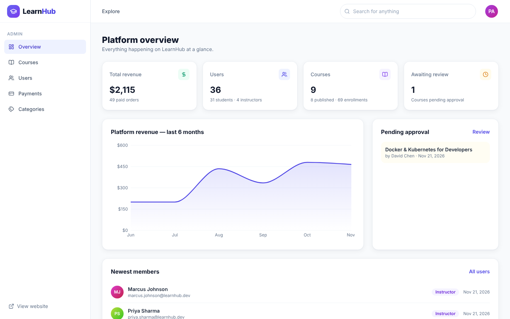

# LearnHub — MERN Learning Management System

A full-featured, production-style **Learning Management System** built with the **MERN stack** (MongoDB, Express, React, Node.js). Students buy and take courses, instructors build and sell them, and admins moderate the whole platform.

**🔗 Live demo:** https://learnhub-lms-azure.vercel.app

> **Try it in one click:** the login page has **Student**, **Instructor** and **Admin** demo buttons.
> Payments run in **demo mode**. Use test card `4242 4242 4242 4242`, any future expiry and any CVC. No real money is ever charged.



---

## ✨ Features

### For students
- Browse the catalog with **search, category, level and price filters**, sorting and pagination
- Course pages with curriculum, **free preview lessons**, outcomes, requirements and instructor profile
- **Free enrollment** or a **Stripe-style checkout** (demo processor with success and decline test cards)
- Distraction-free **lesson player**: YouTube, Vimeo or MP4 video, curriculum sidebar, downloadable resources
- **Progress tracking**: mark lessons complete, auto-complete when a video ends, "continue where you left off"
- **Quizzes** with server-side grading, explanations, pass marks and retakes
- **My Learning** dashboard, purchase history and profile settings

### For instructors
- Dashboard with **revenue, students, rating and completion KPIs** and a **6-month revenue chart**
- **Course builder**: details, artwork themes, outcomes and requirements
- **Curriculum builder**: sections and lessons, reordering, preview toggles and **file attachments** (PDF, DOC, ZIP…)
- **Quiz builder** with multiple-choice questions and explanations
- Publishing checklist and **submit-for-review** workflow
- Students table with per-course progress

### For admins
- Platform overview: revenue, users, courses, enrollments and the review queue
- **Course moderation**: approve, reject with feedback, or take down
- **User management**: change roles, block and unblock accounts
- Payments ledger and category management

---

## 🧱 Tech stack

| Layer | Tech |
|---|---|
| Frontend | React 18, Vite, React Router 6, Tailwind CSS, Recharts, Lucide icons |
| Backend | Node.js, Express 4, Mongoose 8, Zod validation, Multer |
| Database | MongoDB Atlas |
| Auth & security | JWT, bcrypt, role-based access control, Helmet, CORS, rate limiting |
| DevOps | Vercel (static frontend + serverless API + daily cron), Docker, ESLint, Prettier |

## 🏗️ Architecture

```
┌──────────────┐  /api/*   ┌──────────────────────┐        ┌───────────────┐
│ React (Vite) │ ───────▶ │ Express API          │ ─────▶ │ MongoDB Atlas │
│ SPA on Vercel│          │ (Vercel serverless)  │        │               │
└──────────────┘          └──────────────────────┘        └───────────────┘
```

```
├── api/index.js          # Vercel serverless entry → Express app
├── server/
│   ├── app.js            # Express app: security middleware, routes, errors
│   ├── config/           # DB connection (cached for serverless), env helpers
│   ├── middleware/       # auth (protect / authorize), validation, errors
│   ├── models/           # User, Course, Category, Enrollment, Quiz, QuizAttempt, Payment, File
│   ├── routes/           # auth, courses, learn, quizzes, checkout, instructor, admin, cron
│   └── seed/             # demo data, seeded automatically on an empty database
├── src/
│   ├── components/       # UI kit, course cards, video player, charts
│   ├── context/          # AuthContext
│   ├── layouts/          # Main and dashboard layouts
│   └── pages/            # auth, courses, student, instructor, admin
├── Dockerfile            # Run the API as a standalone container
└── vercel.json           # Rewrites, function config, daily demo-reset cron
```

### API overview

| Area | Endpoints |
|---|---|
| Auth | `POST /api/auth/register` · `POST /api/auth/login` · `POST /api/auth/demo/:role` · `GET /api/auth/me` · `PUT /api/auth/profile` · `PUT /api/auth/password` |
| Catalog | `GET /api/courses` · `GET /api/courses/:slug` · `GET /api/categories` |
| Learning | `POST /api/enrollments/:courseId` · `GET /api/enrollments/me` · `GET /api/learn/:courseId` · `POST /api/learn/:courseId/lessons/:lessonId/complete` |
| Quizzes | `GET /api/quizzes/:id` · `POST /api/quizzes/:id/attempt` |
| Payments | `POST /api/checkout` · `GET /api/checkout/history` |
| Instructor | `GET /api/instructor/stats` · CRUD `/api/instructor/courses` · `PUT …/curriculum` · `PUT …/quiz` · `POST …/files` · `POST …/submit` · `GET /api/instructor/students` |
| Admin | `GET /api/admin/stats` · `/api/admin/users` · `/api/admin/courses` (approve / reject) · `/api/admin/payments` |

---

## 🚀 Getting started

```bash
git clone https://github.com/HamzaFaisal10/LMS-project.git
cd LMS-project
npm install
cp .env.example .env      # add your MongoDB connection string
npm run dev               # web on :5173, API on :5000
```

The database is **seeded automatically** on first run with demo users, 9 courses, quizzes, enrollments and payments.

| Role | Email | Password |
|---|---|---|
| Student | student@learnhub.dev | demo1234 |
| Instructor | instructor@learnhub.dev | demo1234 |
| Admin | admin@learnhub.dev | demo1234 |

### Environment variables

| Name | Required | Description |
|---|---|---|
| `MONGODB_URI` | ✅ | MongoDB connection string |
| `JWT_SECRET` | – | JWT signing secret (derived from the DB URI if omitted) |
| `CRON_SECRET` | – | Protects the demo-reset cron endpoint |

### Run the API with Docker

```bash
docker build -t learnhub-api .
docker run -p 5000:5000 --env-file .env learnhub-api
```

---

## 🖼️ Screenshots

| Lesson player | Instructor dashboard |
|---|---|
|  |  |



## 🗺️ Roadmap
- Assignments with file submissions and instructor grading
- Subscription plans and completion certificates
- Course reviews and lesson Q&A
- Email notifications

---

Built by **Hamza Faisal**
